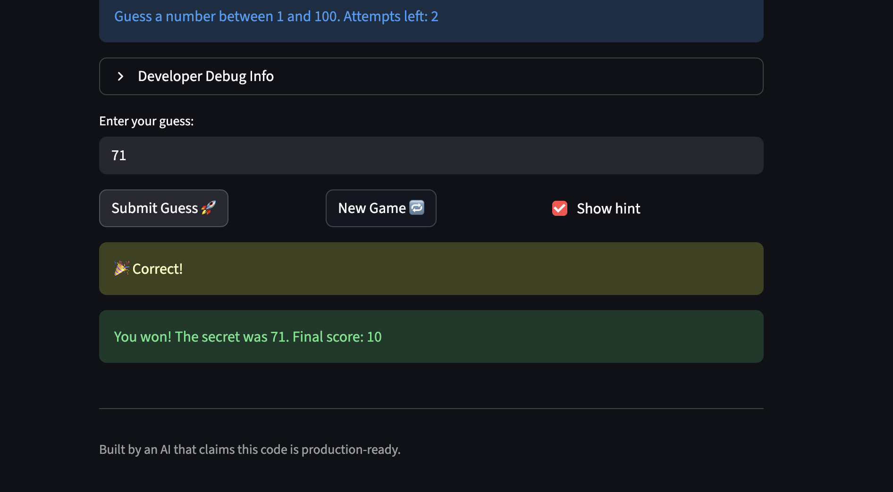

# 🎮 Game Glitch Investigator: The Impossible Guesser

## 🚨 The Situation

You asked an AI to build a simple "Number Guessing Game" using Streamlit.
It wrote the code, ran away, and now the game is unplayable. 

- You can't win.
- The hints lie to you.
- The secret number seems to have commitment issues.

## 🛠️ Setup

1. Install dependencies: `pip install -r requirements.txt`
2. Run the broken app: `python -m streamlit run app.py`

## 🕵️‍♂️ Your Mission

1. **Play the game.** Open the "Developer Debug Info" tab in the app to see the secret number. Try to win.
2. **Find the State Bug.** Why does the secret number change every time you click "Submit"? Ask ChatGPT: *"How do I keep a variable from resetting in Streamlit when I click a button?"*
3. **Fix the Logic.** The hints ("Higher/Lower") are wrong. Fix them.
4. **Refactor & Test.** - Move the logic into `logic_utils.py`.
   - Run `pytest` in your terminal.
   - Keep fixing until all tests pass!

## 📝 Document Your Experience

- [x] **Game's purpose:** A Streamlit number-guessing game. You pick a difficulty, then guess a secret number within that difficulty's range. After each guess the game tells you to go higher or lower, until you win or run out of attempts.
- [x] **Bugs I found:**
  - The hints were backwards. Guessing 50 when the secret was 40 said "Go HIGHER."
  - On every other attempt the secret was turned into a string, so guesses were compared as text instead of numbers.
  - Guesses outside the range, like 110 or -10, were accepted and used up an attempt.
- [x] **Fixes I applied:**
  - Moved `check_guess` and `parse_guess` from `app.py` into `logic_utils.py`.
  - `check_guess` now compares numbers and gives the right hint: too high says "Go LOWER," too low says "Go HIGHER."
  - Removed the code that turned the secret into a string.
  - `parse_guess` now rejects guesses outside the difficulty's range with an error, and invalid guesses no longer count as an attempt.
  - Added pytest cases for wins, high/low hints, and out-of-range input.

## 📸 Demo Walkthrough

Describe your fixed game in numbered steps so a reader can follow along without watching a video:

Sample game on **Normal** (range 1 to 100, 8 attempts), with a secret number of 55:

1. User enters a guess of 40 → game returns "Too Low" with the hint "📈 Go HIGHER!" Score: -5.
2. User enters a guess of 70 → game returns "Too High" with the hint "📉 Go LOWER!" Score: -10.
3. User enters a guess of 110 → game shows the error "Guess must be between 1 and 100." The guess isn't scored and doesn't use up an attempt.
4. User enters a guess of 55 → game shows "🎉 Correct!" and balloons. Score: 40.
5. Game ends with "You won! The secret was 55. Final score: 40", and further guesses are blocked until you start a new game.



## 🧪 Test Results

```
$ python3 -m pytest tests/ -v
============================= test session starts ==============================
platform darwin -- Python 3.9.6, pytest-8.4.2, pluggy-1.6.0 -- /Applications/Xcode.app/Contents/Developer/usr/bin/python3
cachedir: .pytest_cache
rootdir: /Users/fred/Desktop/VSCode/ai110-module1show-gameglitchinvestigator-starter
collecting ... collected 13 items

tests/test_game_logic.py::test_winning_guess PASSED                      [  7%]
tests/test_game_logic.py::test_guess_too_high PASSED                     [ 15%]
tests/test_game_logic.py::test_guess_too_low PASSED                      [ 23%]
tests/test_game_logic.py::test_numeric_comparison_not_lexicographic PASSED [ 30%]
tests/test_game_logic.py::test_parse_valid_guess_in_range PASSED         [ 38%]
tests/test_game_logic.py::test_parse_range_boundaries_are_inclusive PASSED [ 46%]
tests/test_game_logic.py::test_parse_guess_above_range PASSED            [ 53%]
tests/test_game_logic.py::test_parse_guess_below_range PASSED            [ 61%]
tests/test_game_logic.py::test_parse_negative_guess_out_of_range PASSED  [ 69%]
tests/test_game_logic.py::test_parse_non_number PASSED                   [ 76%]
tests/test_game_logic.py::test_parse_empty PASSED                        [ 84%]
tests/test_game_logic.py::test_regression_guess_50_secret_40_says_go_lower PASSED [ 92%]
tests/test_game_logic.py::test_regression_guess_110_rejected_on_normal_range PASSED [100%]

============================== 13 passed in 0.01s ==============================
```

## 🚀 Stretch Features

- [ ] [If you choose to complete Challenge 4, describe the Enhanced UI changes here — a screenshot is optional]
